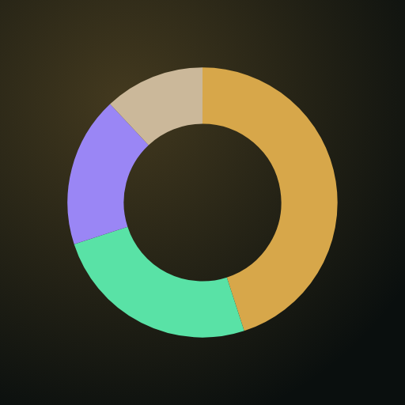
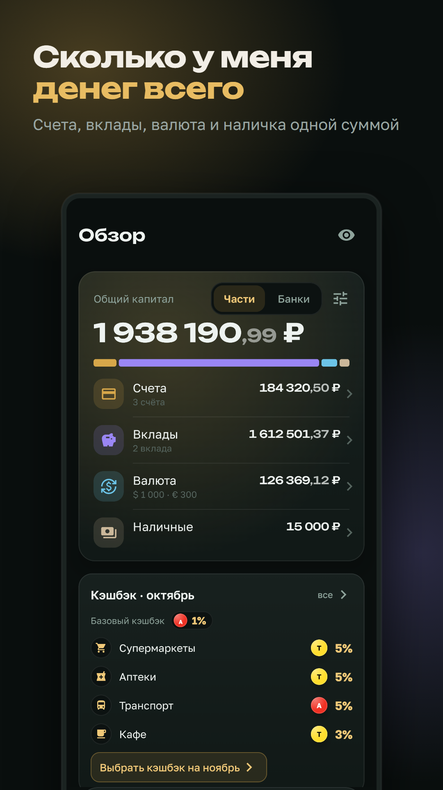
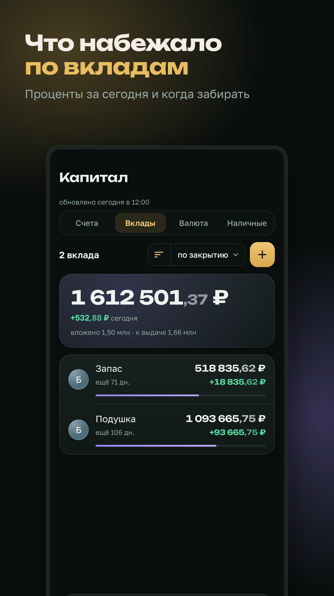
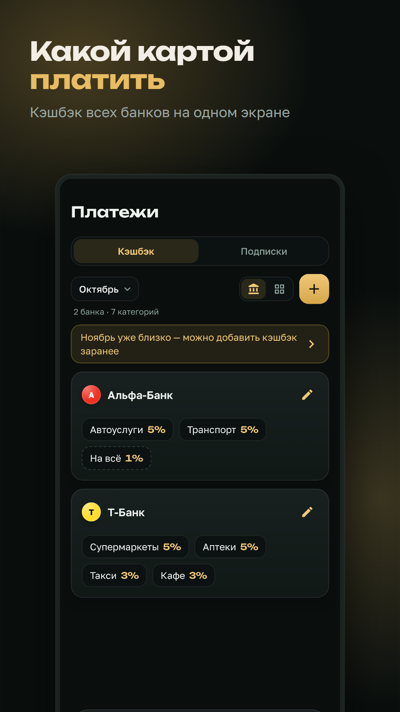
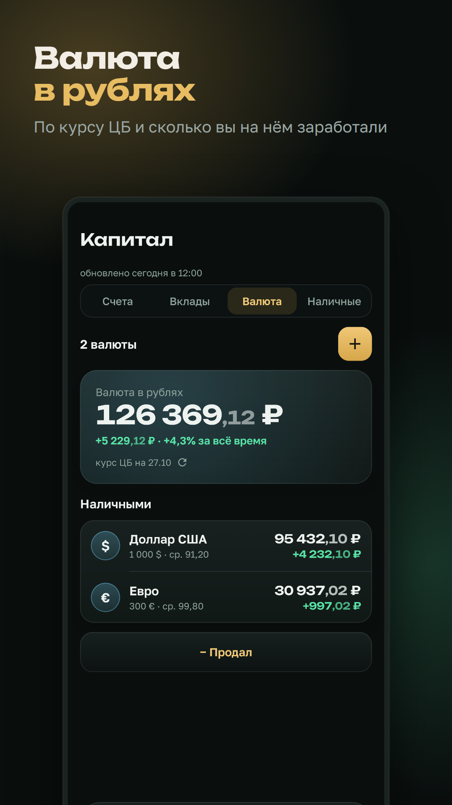
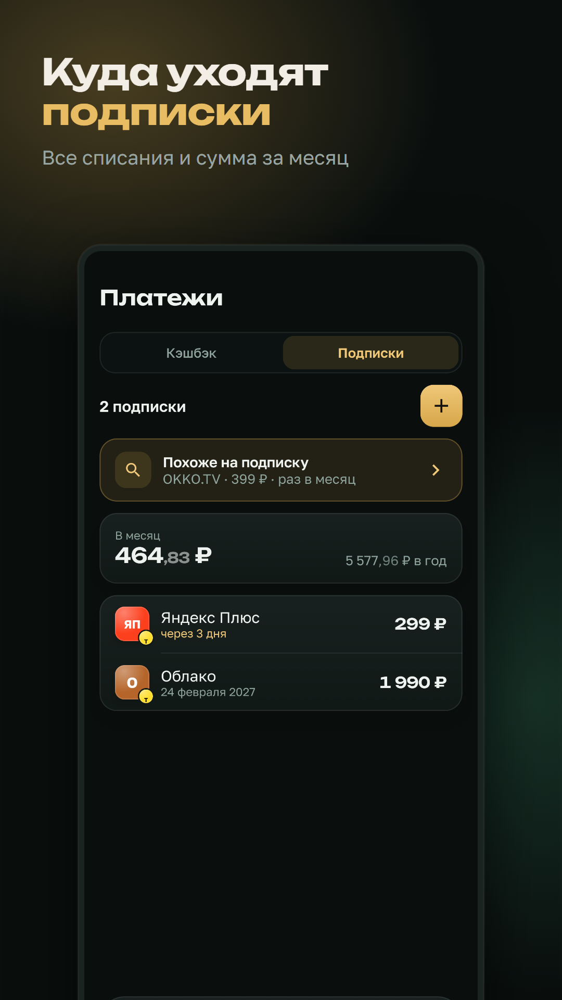

# Itogo

Сколько у вас денег на самом деле: все счета, вклады, валюта и наличные одной суммой. Приложение для Android само записывает операции и остатки из push-уведомлений банков, ничего не нужно вводить руками.

Все данные хранятся только на телефоне, в зашифрованной базе. Сервера и аккаунта нет, в интернет приложение ходит только за курсами валют ЦБ РФ.

  
  
  
  
  

## Что внутри

- **Общий капитал:** счета, вклады, валюта по курсу ЦБ и наличные, по частям или по банкам.
- **Вклады:** проценты за сегодня, сколько выдадут и когда забирать.
- **Кэшбэк:** категории всех карт на одном экране, их можно добавить со скриншота.
- **Подписки:** все регулярные списания и сумма за месяц.
- **Виджет** на главный экран, вход по пин-коду или отпечатку.

[Политика конфиденциальности](privacy)
